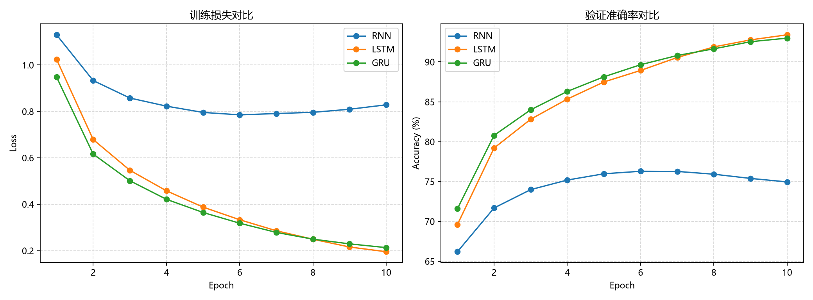

# NLP 自然语言处理练习合集

整理自 NLP 课程练习，覆盖 RNN 人名分类、fastText 和预训练 Transformer 模型实践。

## Requirements

- Python 3.10+
- PyTorch、Transformers、fastText
- 依赖见 requirements.txt

## Installation

~~~bash
git clone https://github.com/Smasun0721/nlp-practice.git
cd nlp-practice
pip install -r requirements.txt
~~~

## Quick start

~~~bash
cd day03
python 03_RNN全球人名分类案例.py
~~~

day10 的预训练模型脚本需要本地模型目录或联网下载 HuggingFace 模型，按脚本中的模型路径调整。

## Contents

| 目录 | 主题 | 主要内容 |
| --- | --- | --- |
| day03 | RNN 人名分类 | 文本长度规范、RNN API、RNN/LSTM/GRU 人名分类、LogSoftmax |
| day10 | 预训练模型实践 | fastText 文本分类、Transformers pipeline、AutoModel、BERT 中文任务 |

## Results

day03 使用 RNN、LSTM、GRU 三种循环网络进行人名国籍分类，训练 10 轮：

| 模型 | 最终验证准确率 |
| --- | ---: |
| RNN | 约 75% |
| LSTM | 约 93% |
| GRU | 约 93% |

## Project structure

~~~text
nlp-practice/
├── day03/
├── day10/
├── docs/
├── requirements.txt
└── README.md
~~~

## Notes

本仓库是 NLP 课程练习合集，保留原始代码和目录结构；day03 的小模型可直接复现实验，day10 的大模型未上传。数据和预训练模型版权归原始提供方所有。
